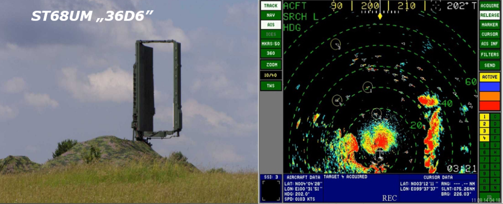
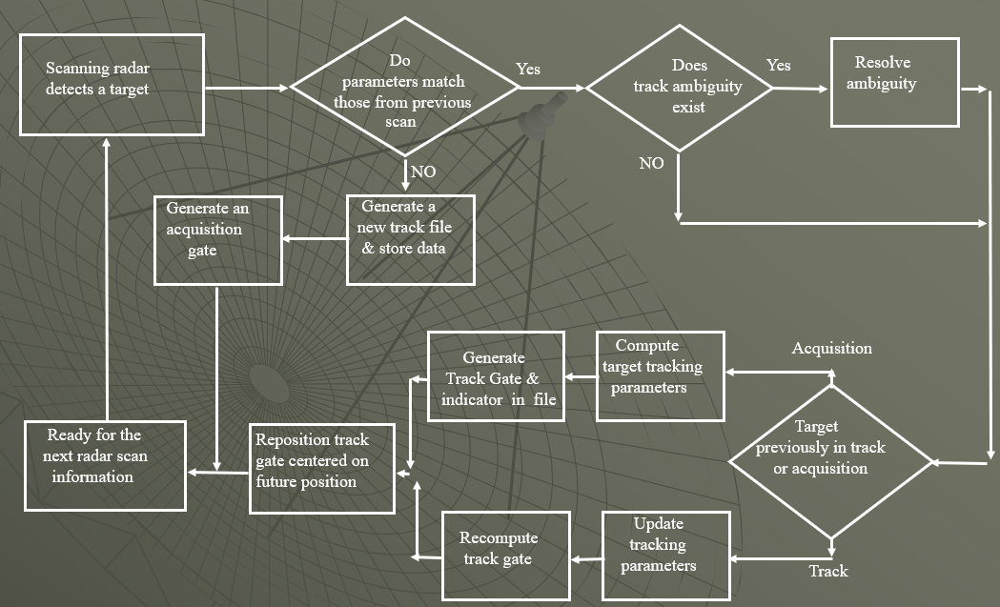
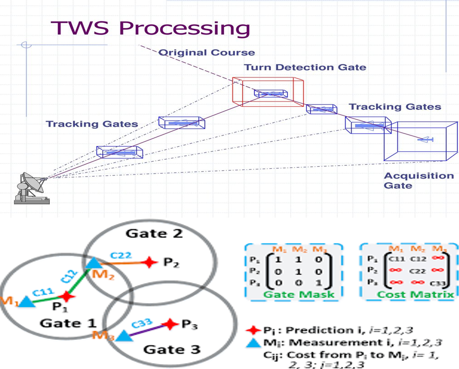
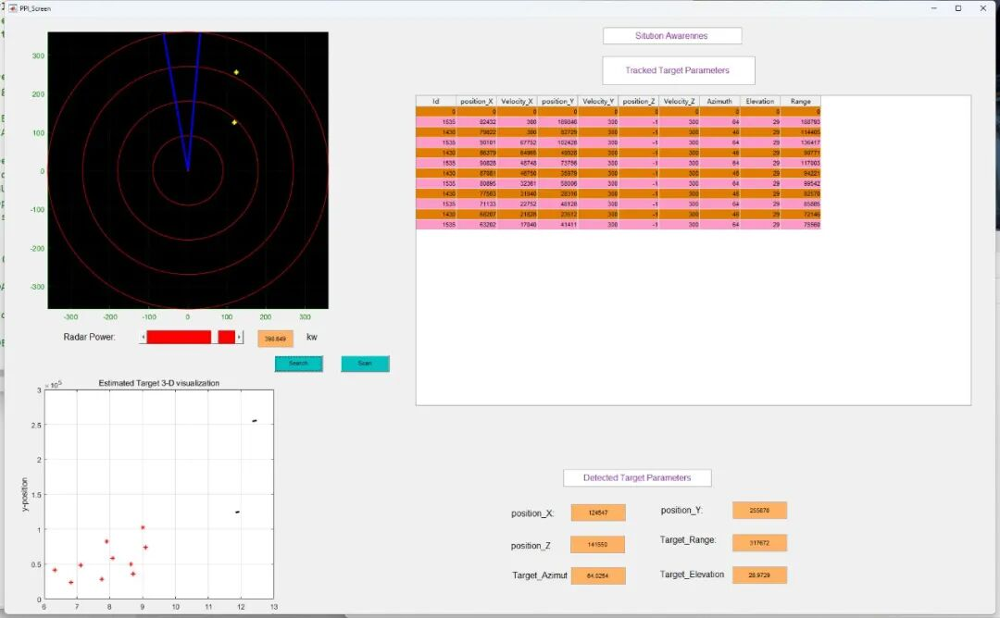

# [TWS Radar]A Comprehensive Understanding of the TWS Radar System: Principles, Core Technologies, and Applications [with PPI interface code]

1. Why is the TWS system needed? The four major pain points of traditional radar systems existed before the birth of TWS technology, which were difficult to adapt to multi-target and high-dynamic application scenarios. The specific problems are as follows:
1  
Single-target tracking limitation: The dedicated fire control (FC) radar can only track one target at a time, unable to handle densely packed multiple targets.
2  
Functional separation inefficiency: The system usually needs to separately equip "scanning radar" and "tracking radar", the hardware architecture is complex, and the synergy efficiency is low.
3  
Tracking Exposure Risk: The target is aware of being tracked, which in turn triggers electronic countermeasures (Counter Measures), reducing radar combat effectiveness.
4  
Dynamic lag problem: Traditional tracking lacks precise position prediction, easily leads to "lag tracking", unable to update the target dynamic in time.
II. Core Concepts of TWS System: Integrated Collaboration for Scanning and Tracking
Simply put, the workflow of TWS system can be summarized as follows:
1  
The scanning radar continuously scans the airspace / sea area to obtain target echo data.
2  
Computer receives scan data, and through algorithm determines "echo is target or noise".
3  
For confirmed targets, establish and maintain "trajectory files" to update parameters such as position and velocity in real-time.
4  
Predict the future position of the target based on historical data, providing a precise basis for fire control or surveillance.
The TWS system interface example provided in the courseware also intuitively demonstrates its core capabilities: by "tracking gate" locking the target, it synchronously displays key data such as target's longitude and latitude, heading (HDG), speed (SPD) etc., to achieve visual monitoring of "scanning while following".
III. TWS System's 6 Core Features: From Target Detection to Trajectory Prediction
The core value of the TWS system lies in its interconnected 6 major functional modules, each playing a crucial role in "data to trajectory":
Functional Modules
Core Functionality
Key Details
Target Detection (Detection)
Identifying "target echoes" from "random noise"
Receives scanned radar outputs, filters out valid targets through signal analysis, and eliminates noise interference
Trajectory Correlation and Matching (Correlation)
Matching new scanned data with existing target trajectories
Split into "gating" and "correlation" steps: first narrows the matching range through a "tracking gate," then uses an algorithm to determine the corresponding relationship between "observed data - target trajectory"
Trajectory Start and File Generation
Establishes exclusive trajectory files for new targets
If a newly detected target cannot be matched with existing trajectories (no correlation), the computer automatically creates a "trajectory file" recording initial position, speed, etc., with subsequent scans continuously updating
Tracking Gate Generation (Gating)
Defines the potential range where a target might appear
Creates a "gate" around the predicted target position, only including observations within the gate in trajectory updates, reducing unnecessary computations
Trajectory Prediction, Smoothing, and Localization
Correct errors, precisely lock onto the target
Due to tracking errors caused by target movement and antenna axis offsets, algorithms (such as Kalman filtering) are needed to: - Predict: calculate the target's next position; - Smooth: filter data noise, optimize trajectories; - Localize: dynamically adjust the "tracking gate" to ensure alignment with the target
Display and Future Position Calculation
Visualized output + fire control support
Real-time display of target trajectories and parameters, and calculation of "fire control solutions" based on predicted positions, providing precise guidance for weapon systems
IV. The "technological heart" of TWS: 2 major core algorithms deconstruct the precision of the TWS system, relying on two core algorithms: data association and filtering prediction. The course emphasizes the global nearest neighbor (GNN) data association algorithm, Kalman filter, and the munkres assignment algorithm for optimization, which together form the "technological engine" of TWS.
1. Kalman Filtering: The core tool for "prediction and smoothing". Kalman Filtering is the key technology for "trajectory prediction and smoothing" in TWS systems, its core function is:
•  
Based on the target's historical motion state (position, velocity), establish a mathematical model to predict the target's position in the next scanning cycle, avoiding "lag tracking".
•  
Incorporating new observational data to correct prediction errors and smooth trajectory fluctuations (such as filtering noise causing position jumps);
•  
Output "Predicted Position" and "Covariance Matrix" (reflecting prediction accuracy) to provide a basis for generating the "Track Gate".
In short, Kalman filtering enables TWS systems to transition from "passive tracking" to "active prediction," significantly improving the tracking accuracy of dynamic targets.
2. GNN+Munkres: Solving "Multi-object Correlated Ambiguity" in a Multi-Objective Dense Environment, often encounters two types of ambiguous scenarios:
•  
An observational data falls within the "tracking gate" of multiple targets;
•  
Multiple observational data fall within the "tracking gate" of the same target.
At this time, the solution needs to be resolved through the "Data Association" algorithm. The courseware adopts a combination scheme of "Global Nearest Neighbor (GNN) + Munkres Assignment Algorithm".
Step 1: Cost Matrix Generation
After "gated" filtering, the cost matrix is generated by quantifying the matching costs between "predicted position (Pi)" and "observation data (Mj)" such as distance or error. If the observation data is not within the "tracking gate", the cost is set to "infinity" (representing no match).
Pseudocode for cost matrix generation:
1 
Get parameters: target prediction range (range), observation data (measurement), error variance;
2 
Initialize a zero-filled cost matrix;
3 
Iterate over each predicted position and observation data:
• 
If the observation data is within the prediction range, fill in the "observation value" at the corresponding position in the matrix;
• 
If not within the range, fill in "infinity";
4 
Output the cost matrix for subsequent matching.

Step 2: Munkers Assignment Algorithm (Optimal Matching)
The Munkers algorithm (also known as the "Hungarian Algorithm") finds the "total matching cost minimum" combination from the cost matrix to solve the optimal correspondence between "predicted - observed", following these steps:
1 
Matrix normalization: Subtract the minimum value from each row / column to simplify calculations;
2 
Zero elements marking: Find the zero elements (indicate "low cost matches") in the matrix, mark "star zero (Z*, determined match)" and "prime zero (Z', candidate match)";
3 
Coverage and adjustment:
• 
Cover columns containing "Z*" if the number of covered columns equals the target number, complete the match;
• 
If not completed, select "Z'" that has not been covered, adjust through "row coverage - column unlocking" until an optimal match is found;
4 
Output result: Obtain the optimal correspondence between "predicted position - observation data", eliminating any ambiguities.
The MATLAB simulation case in the courseware shows that the time spent by the Munkres algorithm to process the cost matrix is only about 0.0087 seconds, which is extremely efficient and fully meets the radar's "real-time tracking" requirements.
V. The 3 major core advantages of the TWS system compared to traditional radars: Integration, Efficiency, and Accuracy.
1  
Scanning and Tracking Integrated: A system that simultaneously achieves "airspace scanning" and "multi-target tracking," simplifying hardware architecture and reducing costs.
2  
Real-time Fire Control Support: Tracking data can be directly used for calculating "Fire Control Decomposition", without the need for additional data conversion, significantly reducing the weapon system response time.
3  
Multi-target adaptability: Through the GNN+Munkres algorithm, it can stably track multiple dense targets with stronger interference resistance.
Its typical application scenarios include:
•  
Military field: Fighter air-to-air missile guidance radar, shipboard anti-aircraft radar, to deal with multiple target incoming;
•  
Civil aviation: Air traffic control radar, tracking multiple civil aircraft simultaneously;
•  
In the field of security: Low-altitude surveillance radar, monitoring multiple drones or low-altitude targets.
VI. Summary: The core logic of the TWS system is the deep collaboration between "radar hardware" and "algorithm software":
•  
The radar continuously scans, providing an endless supply of observational data.
•  
Computers predict the target's position through "Kalman Filter", and associate data through "GNN+Munkres".
•  
Ultimately, it achieves "scanning, tracking, and prediction" in real-time, providing precise target information for monitoring or fire control.
With the development of new equipment such as drones and hypersonic weapons, TWS systems will also upgrade towards "higher precision, more targets, stronger interference resistance", becoming the core component of modern perception systems.
End

## Images

<!-- PAYMENT_BLOCK -->

## Get this dataset

- Payment link (Stripe): [Buy now](https://buy.stripe.com/3cs8yP7sY87d0vu9AB)
- Payment QR code: 

<!-- /PAYMENT_BLOCK -->
